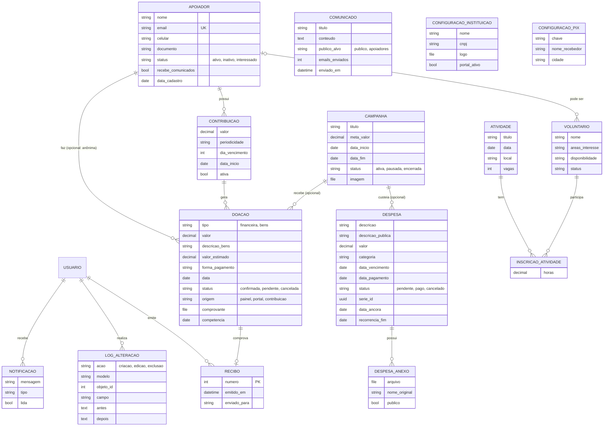

# Revisão do artigo do TCC em relação ao sistema implementado

Base da comparação: o artigo `Artigo final.docx`/`.pdf` e o código das branches `fase-0` a `fase-6`. Cada fase parte da anterior e o conteúdo final está em `fase-6-implantacao`; até esta revisão, nenhuma foi mesclada na `main`.

Os textos sugeridos seguem o estilo do artigo: português formal e terceira pessoa. Onde o dado depende de medição ou de informação dos autores, aparece `[preencher]`. Os números citados (quantidade de testes e notas do Lighthouse) vêm das execuções registradas em `docs/progresso.md`.

## Tabela de revisão

| # | Trecho do artigo | Situação no sistema | Texto sugerido |
|---|---|---|---|
| 1 | **RF01** (Quadro 1): “Autenticação de usuários com suporte a login tradicional (e-mail e senha) e autenticação social via conta Google.”  **Implementação dos módulos**: “login tradicional com e-mail e senha […] e login social com conta Google, implementado por meio de um endpoint dedicado que recebe o e-mail e o nome do usuário autenticado pelo frontend via API do Google.” | **Login tradicional:** usa **nome de usuário e senha** (`username`, padrão do Django), em `/api/auth/token/`. Só usuários da equipe (`is_staff`) e ativos recebem tokens. Membros da equipe convidados pela tela Equipe têm o e-mail como nome de usuário. O superusuário criado por `createsuperuser` pode ter outro nome.  **Google:** o backend **não recebe e-mail e nome**. Recebe o `id_token` (credential) emitido pelo Google e o valida com `google.oauth2.id_token.verify_oauth2_token`: assinatura, emissor, validade e destinatário (`GOOGLE_CLIENT_ID`). Também exige `email_verified`. Só entra quem já existe como usuário ativo da equipe com aquele e-mail; nenhuma conta é criada automaticamente.  **Novos fluxos:** recuperação de senha por e-mail e convite de novos membros da equipe. | **RF01**: Autenticação dos membros da equipe por nome de usuário e senha ou por conta Google, com recuperação de senha por e-mail; apenas usuários previamente cadastrados e ativos têm acesso ao painel.  **Implementação**: O módulo de autenticação oferece dois fluxos. No login tradicional, o usuário informa nome de usuário e senha ao endpoint de token do Django REST Framework, que só emite os tokens para contas ativas pertencentes à equipe administrativa. No login com Google, o frontend obtém do Google um token de identidade (*id_token*) e o envia ao backend. Este valida a assinatura, o emissor, a validade e o destinatário do token com a biblioteca google-auth e verifica se o e-mail foi confirmado pelo Google. O acesso é concedido apenas quando já existe um usuário ativo da equipe com o mesmo e-mail, de modo que contas não autorizadas não são criadas automaticamente. Novos membros da equipe são incluídos por convite enviado por e-mail, com link válido por 72 horas para a definição da senha. |
| 2 | **RNF02**: “tokens JWT com expiração configurável e suporte a renovação de token.”  **RNF03**: “controle de permissões baseado em autenticação.” | **Tokens:**<ul><li>access token com validade padrão de 60 minutos (`JWT_ACCESS_MINUTOS`);</li><li>refresh token de 7 dias, **rotacionado** a cada renovação;</li><li>o refresh anterior vai para a **lista de bloqueio** (`token_blacklist`), e o logout também revoga o refresh.</li></ul>**Limite de tentativas por IP:**<ul><li>10/min no login, no login com Google, na recuperação de senha e na ativação de convite;</li><li>5/min na doação pública.</li></ul>**Permissões:**<ul><li>a API é negada por padrão: só a equipe (`IsAdminUser`), exceto as rotas públicas declaradas;</li><li>o **superusuário** (administrador geral) também gerencia a equipe, consulta o histórico de auditoria, altera os dados da instituição, a chave PIX e o portal, e anonimiza membros;</li><li>não é possível ficar sem administrador geral ativo.</li></ul> | **RNF02**: Autenticação por tokens JWT de curta duração (60 minutos, configurável), com renovação por token de atualização rotacionado, revogação no encerramento da sessão e limitação de tentativas de login por endereço IP.  **RNF03**: API RESTful com acesso negado por padrão e controle de permissões por perfil: operador (equipe), com acesso aos cadastros, e administrador geral, que também gerencia usuários, configurações institucionais e trilha de auditoria; rotas públicas restritas ao portal de transparência. |
| 3 | **RF03/RF04**: “controle de meta e progresso atualizado automaticamente”; “atualização automática do valor arrecadado.”  **Modelagem**: “ao persistir ou alterar uma doação com status confirmado, o sistema atualiza automaticamente o campo de valor arrecadado da campanha.”  **Implementação**: “Ao confirmar uma doação, o sistema atualiza automaticamente o valor arrecadado.” | Não existe mais campo armazenado de valor arrecadado. O valor é **calculado por agregação** (soma) das doações **financeiras confirmadas** da campanha, por subconsulta. Assim, não há divergência possível entre o total e as doações.  O progresso é `arrecadado / meta`, sem limite em 100% (mostra quanto a meta foi superada).  Campanha com doações não pode ser excluída; o caminho é encerrá-la. A campanha também passa a mostrar o **gasto** (despesas pagas vinculadas) e o **saldo**. Doações em bens não entram no valor arrecadado. | **RF03**: Cadastro, edição e encerramento de campanhas de arrecadação, com meta, valor arrecadado, gasto e saldo calculados a partir dos registros vinculados.  **RF04**: Registro de doações financeiras e em bens, vinculadas opcionalmente a um membro e a uma campanha, com forma de pagamento, comprovante e confirmação pela equipe.  **Modelagem/Implementação**: O valor arrecadado não é armazenado na entidade Campanha. É obtido por agregação das doações financeiras confirmadas a ela vinculadas, o que elimina inconsistências entre o total exibido e os registros de doação. O percentual de progresso resulta da razão entre esse valor e a meta. Uma campanha que já recebeu doações não pode ser excluída, apenas encerrada, o que preserva o histórico financeiro. |
| 4 | **RF06**: “despesas fixas recorrentes (semanal, mensal ou anual).”  **Implementação**: “o sistema gera automaticamente a próxima ocorrência com base no período de recorrência configurado […] no momento em que a despesa corrente é marcada como paga.”  **Considerações finais**: “geração automática de ocorrências futuras.” | **Confere em parte.** A próxima ocorrência é gerada **somente quando a atual é marcada como paga** e não há geração antecipada de ocorrências futuras.  As datas são calculadas a partir da **data-âncora** da série (primeiro vencimento) mais *n* períodos, e não a partir da ocorrência anterior. Assim, 31/01 gera 28/02 e depois 31/03, sem deriva.  A série tem identificador e número da ocorrência, e uma restrição única impede ocorrências duplicadas.  A série pode ter **data de fim**: ao encerrá-la, as pendentes posteriores são removidas. O novo valor pode ser aplicado às próximas ocorrências.  O status “atrasado” não é gravado: é calculado (pendente com vencimento passado). As despesas também podem ser canceladas e vinculadas a uma campanha. | **RF06**: Controle de despesas por categoria e por campanha, com status de pagamento, anexos comprobatórios e despesas fixas recorrentes (semanais, mensais ou anuais) organizadas em séries.  **Implementação**: As despesas fixas formam uma série com data-âncora, correspondente ao primeiro vencimento. Cada nova ocorrência tem o vencimento calculado a partir dessa data, acrescida do número de períodos decorridos, o que evita deslocamentos em meses de durações diferentes. A ocorrência seguinte é gerada no momento em que a ocorrência corrente é marcada como paga, e uma restrição no banco de dados impede duplicidades. O gestor pode encerrar a série em uma data, removendo as ocorrências pendentes posteriores, ou aplicar um novo valor às próximas ocorrências. Despesas pendentes com vencimento vencido são exibidas como atrasadas por cálculo, sem alteração do registro. |
| 5 | **RF07**: “comunicados institucionais com segmentação de público-alvo (público geral ou somente apoiadores).” | **Comunicados públicos:** aparecem no portal.  **Comunicados “Somente Membros”:** não aparecem no portal e podem ser **enviados por e-mail** aos membros ativos que aceitam receber.<ul><li>Envio em lotes, até 300 destinatários pela tela; acima disso, comando `enviar_comunicado`.</li><li>O sistema registra quantos e-mails foram enviados e quando.</li><li>Cada e-mail traz **link de descadastro** assinado e o cabeçalho `List-Unsubscribe`.</li><li>Um comunicado é enviado uma única vez.</li></ul>Na interface, o termo “Membro” substitui “Apoiador”. | **RF07**: Publicação de comunicados institucionais com segmentação de público: comunicados públicos, exibidos no portal de transparência, e comunicados restritos aos membros, que podem ser enviados por e-mail aos membros ativos, com registro da quantidade de envios e opção de descadastro em cada mensagem. |
| 6 | **RF08**: “Exportação de relatórios em formato CSV para doações, campanhas e apoiadores, compatíveis com Microsoft Excel.” | **CSV:** quatro relatórios (doações, campanhas, membros e **despesas**).<ul><li>Separador `;`, vírgula decimal, datas dd/mm/aaaa e codificação UTF-8 com BOM, como o Excel em português espera.</li><li>Filtros de **período** (`data_inicio`, `data_fim`) e de status.</li><li>O de doações também filtra por tipo (financeira/bens).</li></ul>**Prestação de contas** por período: página **HTML imprimível** com dados da instituição, receitas por campanha, despesas por categoria e lista de despesas pagas. O navegador salva como PDF; **não há geração de PDF no servidor**. O recibo de doação segue o mesmo modelo. | **RF08**: Exportação de relatórios em CSV (doações, campanhas, membros e despesas), com filtros por período e status e formato compatível com o Microsoft Excel em português, e emissão do relatório de prestação de contas por período em página preparada para impressão ou gravação em PDF.  **Implementação**: Os arquivos CSV utilizam ponto e vírgula como separador, vírgula decimal e datas no formato DD/MM/AAAA, o que permite a abertura direta no Microsoft Excel configurado em português. O relatório de prestação de contas reúne os dados da instituição, as receitas por campanha, as despesas pagas por categoria e o saldo do período, apresentados em página com formatação de impressão, que pode ser salva em PDF pelo próprio navegador. |
| 7 | **RF09**: “Painel público de transparência com dados anonimizados.”  **RNF04**: “Dados sensíveis de doadores anonimizados no painel público.”  **Implementação**: “as doações mais recentes com os dados dos doadores anonimizados — preservando apenas o primeiro nome e a inicial do último sobrenome.” | **A lista de “doações recentes anonimizadas” não existe mais no portal**: foi substituída pelos comunicados públicos. O portal **não exibe nenhum dado de doador**, nem nome parcial. Mostra:<ul><li>total arrecadado, doações do mês, membros ativos, gastos pagos do mês (com lista) e horas de voluntariado (total agregado);</li><li>campanhas em andamento com progresso, gráficos com alternativa em tabela e QR Code PIX;</li><li>**prestação de contas anual**: recebido, gasto, saldo, gasto por categoria e evolução mensal;</li><li>despesas com a **descrição pública** definida pela equipe (sem ela, só a categoria); despesas de Recursos Humanos agregadas, sem nomes;</li><li>**comprovantes** marcados como públicos (nunca os de RH);</li><li>**página por campanha** (`/transparencia/campanha/:id`) e link de compartilhamento com prévia (`/c/:id/`);</li><li>dados de contato da instituição.</li></ul>**Proteção de dados:**<ul><li>anexos privados ficam fora da pasta pública e só são baixados pela API autenticada;</li><li>a doação pelo portal pede consentimento e registra a data;</li><li>a página de Privacidade explica o tratamento;</li><li>o portal pode ser desligado pelo administrador. Ver também item 14 (LGPD).</li></ul> | **RF09**: Portal público de transparência, acessível sem autenticação, com indicadores financeiros, campanhas em andamento, gastos do mês, prestação de contas anual, comprovantes de despesas autorizados pela organização, página individual de cada campanha e doação por PIX.  **RNF04**: Nenhum dado pessoal de doadores ou membros é exibido no portal público; as despesas são apresentadas por descrição pública ou categoria, e as de recursos humanos de forma agregada.  **Implementação**: O portal de transparência é composto por endpoints públicos que expõem apenas dados agregados ou explicitamente liberados pela organização. São apresentados os totais arrecadados e gastos, as campanhas em andamento com o respectivo progresso, a prestação de contas anual com o saldo e a distribuição dos gastos por categoria, além dos comprovantes que a equipe marcou como públicos. Nenhuma informação que identifique doadores é divulgada. As despesas são exibidas com uma descrição pública definida pela equipe ou apenas pela categoria, e os gastos com recursos humanos aparecem de forma agregada, o que preserva a privacidade dos colaboradores. Cada campanha possui página própria, com link de compartilhamento que gera pré-visualização nas redes sociais. |
| 8 | **Modelagem do sistema**: “resultando em sete entidades principais” (Apoiador, Campanha, Doação, Despesa, DespesaAnexo, Comunicado, Notificação). Campanha com “valor arrecadado acumulado”. | O modelo tem **15 entidades** do domínio, mais o Usuário do Django:<ul><li>Apoiador (Membro);</li><li>Campanha;</li><li>Doação;</li><li>Contribuição;</li><li>Recibo;</li><li>Despesa;</li><li>DespesaAnexo;</li><li>Comunicado;</li><li>Notificação;</li><li>LogAlteracao;</li><li>ConfiguracaoInstituicao;</li><li>ConfiguracaoPix;</li><li>Voluntário;</li><li>Atividade;</li><li>InscricaoAtividade.</li></ul>A Campanha não armazena mais o valor arrecadado. Diagrama e descrição no **Apêndice A**. | Substituir o parágrafo pelo texto do **Apêndice A** e incluir a figura do diagrama entidade-relacionamento (Figura X: “Modelo entidade-relacionamento do sistema”, fonte: elaborado pelos autores, 2026). |
| 9 | Ausente no artigo. | Funcionalidades implementadas e não descritas:<ul><li>**PIX “copia e cola”** no padrão EMV (BR Code) do Banco Central, com CRC16 validado pelo exemplo oficial, e **QR Code** gerado no navegador, por campanha e para doação geral; chave PIX validada e exibida mascarada; intenção de doação registrada pelo portal;</li><li>**compartilhamento** de campanhas (WhatsApp, Facebook, LinkedIn, Instagram, TikTok e link) com prévia Open Graph;</li><li>**notificações** internas (doações, campanhas, membros, despesas, configurações e meta atingida);</li><li>**auditoria**: histórico de criação, edição e exclusão com valores antes/depois;</li><li>**recibos**;</li><li>**voluntários**;</li><li>contribuições periódicas;</li><li>doações em bens;</li><li>**gestão da equipe**;</li><li>**dados da instituição**.</li></ul> | Incluir, em **Implementação dos módulos**, os parágrafos do **Apêndice B**. |
| 10 | **Ferramentas e linguagens** e **Metodologia** (primeira e quarta fases): “HTML5 para estruturação das páginas, CSS3 para estilização da interface, JavaScript […]”; quarta fase “utilizando HTML5, CSS3 e JavaScript”; sexta fase “testes, validação e finalização do projeto.” | A interface foi construída com:<ul><li>**React 19** (componentes em JSX);</li><li>**Vite** (servidor de desenvolvimento e build);</li><li>**Tailwind CSS 4** (estilização por classes utilitárias);</li><li>React Router 7, axios, Recharts e qrcode.react.</li></ul>HTML, CSS e JavaScript são a base gerada, não escrita diretamente.  **Testes realizados:**<ul><li>**246 testes automatizados do backend** (`django.test`), em MySQL e SQLite;</li><li>**18 testes do frontend** (Vitest + Testing Library);</li><li>análise estática com oxlint;</li><li>**integração contínua** no GitHub Actions a cada envio de código;</li><li>auditoria de acessibilidade com Lighthouse.</li></ul>**A cobertura de código não foi medida.** | **Ferramentas e linguagens**, após o parágrafo do React: Para a construção da interface, utilizou-se o Vite como ferramenta de desenvolvimento e empacotamento, que gera os arquivos HTML, CSS e JavaScript otimizados servidos ao navegador, e o Tailwind CSS, framework de estilização baseado em classes utilitárias que favorece a consistência visual e a responsividade. Os gráficos são produzidos com a biblioteca Recharts.  **Primeira fase**: Nesta etapa foram definidas as tecnologias: Python e Django, com o Django REST Framework, para o backend; React, Vite e Tailwind CSS para o frontend; MySQL para o armazenamento dos dados; e Git e GitHub para o versionamento, além de ferramentas de prototipagem e de edição de código.  **Quarta fase**: Construção da interface gráfica com React e Tailwind CSS, por meio de componentes reutilizáveis para menus de navegação, formulários, tabelas, gráficos e janelas de diálogo, com atenção à responsividade e à acessibilidade.  **Sexta fase**: Testes e validação. Foram escritos testes automatizados para as regras de negócio do backend (246 casos) e para funções e componentes do frontend (18 casos), executados automaticamente a cada alteração por integração contínua no GitHub Actions, além de auditoria de acessibilidade com a ferramenta Lighthouse e de validação com usuários (ver “Resultados e validação”). [preencher: cobertura de código, se for medida com coverage.py] |
| 11 | Ausente: não há seção de resultados. | Dados disponíveis:<ul><li>246 testes de backend e 18 de frontend, todos passando;</li><li>CI aprovada;</li><li>Lighthouse (Acessibilidade): **antes** Login 90, Painel 90, Doações 95, Transparência 94; **depois** 100 nas quatro telas, nos temas claro e escuro.</li></ul>A validação com usuários (SUS) ainda **não foi realizada**. | Criar a seção **“Resultados e validação”** com o texto do **Apêndice C** (testes, Lighthouse, roteiro de validação e questionário SUS). |
| 12 | **Considerações finais**: “Como limitações do presente trabalho, aponta-se a ausência de testes automatizados e a não implementação de um módulo de gestão de voluntários […]. Para trabalhos futuros, sugere-se […] autenticação multifator, a integração com plataformas de pagamento digital […], o desenvolvimento do módulo de gestão de voluntários e […] relatórios gerenciais com visualizações gráficas avançadas […] multi-tenant.” | Já resolvidos:<ul><li>testes automatizados;</li><li>módulo de voluntários;</li><li>parte dos relatórios gráficos (receitas × despesas, saldo acumulado, prestação de contas anual);</li><li>arquivos de implantação com Docker e guia.</li></ul>Ainda não feitos:<ul><li>multi-tenant;</li><li>autenticação multifator;</li><li>gateway de pagamento com confirmação automática (hoje o PIX é confirmado manualmente pela equipe);</li><li>recibo em PDF gerado no servidor;</li><li>fila assíncrona para e-mails;</li><li>publicação em produção [preencher, se ocorrer].</li></ul> | Substituir o último parágrafo pelo texto do **Apêndice D**. |
| 13 | **Referências**: “DJANGO SOFTWARE FOUNDATION. Getting started \| Django documentation. Disponível em: https://docs.djangoproject.com/en/6.0/intro/.” | O sistema usa **Django 5.2** (LTS). | DJANGO SOFTWARE FOUNDATION. **Getting started**: Django 5.2 documentation. Disponível em: https://docs.djangoproject.com/en/5.2/intro/. Acesso em: [preencher].  Se o Apêndice C for adotado, incluir também:<ul><li>BROOKE, John. SUS: a “quick and dirty” usability scale. In: JORDAN, P. W. *et al.* (ed.). **Usability evaluation in industry**. London: Taylor & Francis, 1996. p. 189-194.</li><li>W3C. **Web Content Accessibility Guidelines (WCAG) 2.1**. 2018. Disponível em: https://www.w3.org/TR/WCAG21/. Acesso em: [preencher].</li><li>BANCO CENTRAL DO BRASIL. **Manual de Padrões para Iniciação do Pix**. Disponível em: https://www.bcb.gov.br/estabilidadefinanceira/pix. Acesso em: [preencher].</li><li>BRASIL. Lei nº 13.709, de 14 de agosto de 2018. **Lei Geral de Proteção de Dados Pessoais (LGPD)**.</li></ul> |
| 14 | **Quadros 1 e 2**: RF01–RF10 e RNF01–RNF05. | Faltam requisitos implementados: prestação de contas, equipe, recibos, voluntários, PIX, LGPD, auditoria e implantação/backup. O RF05 diz “filtro por status (ativo/inativo)”; hoje há também o status **interessado** (membro vindo do portal, que passa a ativo quando a primeira doação é confirmada). | Ajustar o **RF05**: Cadastro e gerenciamento de membros, com documento (CPF/CNPJ) validado, contribuições periódicas, preferência de recebimento de comunicados e situação (ativo, inativo ou interessado).  Acrescentar os requisitos do **Apêndice E**. |

---

## Apêndice A — Modelagem do sistema (texto e diagrama)

**Texto sugerido**

A modelagem do banco de dados resultou em quinze entidades, além da entidade de usuários fornecida pelo Django, que representa os membros da equipe administrativa.

- **Membros e doações**:
  - A entidade **Apoiador**, apresentada na interface como Membro, armazena nome, e-mail, celular, documento (CPF ou CNPJ), situação, data de cadastro e a preferência de recebimento de comunicados.
  - A entidade **Doação** registra cada contribuição com tipo (financeira ou em bens), valor, forma de pagamento, data, situação, origem (painel, portal ou contribuição periódica), observação e comprovante. Ela se relaciona, de forma opcional, com um membro (doações anônimas não têm membro) e com uma campanha.
  - A entidade **Contribuição** representa mensalidades e outras contribuições periódicas de um membro. A partir dela, o sistema gera doações pendentes a cada período.
  - A entidade **Recibo** associa-se de forma única a uma doação confirmada e tem numeração sequencial.
- **Campanhas e despesas**:
  - A entidade **Campanha** guarda título, meta, período, situação, descrição e imagem. O valor arrecadado e o gasto são obtidos por agregação das doações e despesas vinculadas.
  - A entidade **Despesa** registra os gastos por categoria, com vencimento, pagamento, situação, descrição pública e vínculo opcional com uma campanha. As despesas fixas formam séries com data-âncora e data de fim.
  - A entidade **DespesaAnexo** guarda os comprovantes de cada despesa e indica quais podem ser exibidos publicamente.
- **Comunicação e registro**:
  - A entidade **Comunicado** registra as publicações, o público-alvo e o envio por e-mail.
  - A entidade **Notificação** armazena os avisos internos de cada usuário da equipe.
  - A entidade **LogAlteracao** compõe a trilha de auditoria, com usuário, ação, registro, campo e valores anterior e posterior.
- **Voluntariado**:
  - As entidades **Voluntário**, **Atividade** e **InscricaoAtividade** formam o módulo de voluntariado. A inscrição relaciona voluntários e atividades, respeita o número de vagas e registra as horas trabalhadas.
- **Configurações**: as entidades **ConfiguracaoInstituicao** (dados públicos da organização e ativação do portal) e **ConfiguracaoPix** (chave, nome do recebedor e cidade) são registros únicos de configuração.

**Diagrama ER sugerido (Mermaid)**

## Apêndice B — Módulos não descritos no artigo

**Doação por PIX.** O portal permite doar por PIX “copia e cola” e por QR Code. O código segue o padrão EMV (BR Code) definido pelo Banco Central do Brasil e é gerado no próprio navegador a partir da chave PIX cadastrada pela organização. Contém o identificador da transação, o valor (quando informado) e o código de verificação CRC16, cuja implementação foi validada com o exemplo oficial do manual do Pix. A intenção de doação é registrada como pendente e confirmada pela equipe ao identificar o recebimento.

**Compartilhamento de campanhas.** Cada campanha possui página pública própria e link de compartilhamento para WhatsApp, Facebook, LinkedIn, Instagram e TikTok. O link gera uma pré-visualização com título, progresso e imagem da campanha nas redes sociais. A funcionalidade responde ao papel das mídias sociais na captação de recursos apontado por Elvira-Lorilla *et al.* (2024), ao facilitar a divulgação pelos próprios apoiadores e a ampliação do alcance das campanhas.

**Notificações internas.** O sistema gera notificações para a equipe quando são registradas doações (inclusive intenções vindas do portal), campanhas, membros e despesas, quando uma campanha atinge a meta e quando as configurações sensíveis, como a chave PIX, são alteradas.

**Auditoria.** Toda criação, edição e exclusão de registros é armazenada numa trilha de auditoria, com o usuário responsável, a data, o campo alterado e os valores anterior e posterior. Os administradores gerais consultam essa trilha em tela própria, com filtros por tipo de registro, ação e período, o que reforça a prestação de contas interna.

**Recibos.** Para cada doação confirmada pode ser emitido um recibo com numeração sequencial e única. O recibo contém os dados da instituição, o nome e o documento do doador, o valor por extenso, a data e a forma de pagamento. Pode ser impresso, salvo em PDF ou enviado por e-mail ao doador.

**Contribuições periódicas e doações em bens.** Mensalidades e outras contribuições recorrentes de membros geram automaticamente, a cada período, doações pendentes de confirmação. As doações em bens (alimentos, roupas, materiais) são registradas com a descrição dos itens e o valor estimado, sem compor os totais financeiros.

**Voluntários.** O módulo de voluntariado permite cadastrar voluntários (vinculados ou não a um membro) e atividades com data, local e número de vagas, inscrever voluntários respeitando esse limite e registrar as horas trabalhadas. O painel apresenta os voluntários ativos e as horas do mês, e o portal divulga o total de horas de forma agregada.

**Gestão da equipe e dados da instituição.** Os administradores gerais convidam novos membros da equipe por e-mail, definem o papel de cada um (operador ou administrador geral) e podem desativar acessos. Os dados da instituição, como nome, CNPJ, logotipo, contatos e redes sociais, são cadastrados no próprio sistema e utilizados no portal, nos relatórios e nos recibos.

## Apêndice C — Seção “Resultados e validação”

**Texto sugerido**

### RESULTADOS E VALIDAÇÃO

**Testes automatizados**
- As regras de negócio do backend são verificadas por 246 testes automatizados, escritos com o framework de testes do Django. Os testes cobrem, entre outros aspectos:
  - permissões de acesso;
  - autenticação com o Google;
  - cálculo do valor arrecadado e dos indicadores;
  - recorrência de despesas;
  - doação pelo portal;
  - privacidade dos dados públicos;
  - recibos e validação de CPF e CNPJ;
  - envio de comunicados;
  - anonimização de membros;
  - limite de vagas de voluntariado.
- No frontend, 18 testes escritos com Vitest e Testing Library verificam:
  - a geração do código PIX, inclusive o código de verificação do exemplo oficial do Banco Central;
  - a formatação de valores e datas;
  - a paginação;
  - a proteção das rotas administrativas;
  - o comportamento acessível das janelas de diálogo.
- Todos os testes são executados automaticamente pelo GitHub Actions a cada alteração enviada ao repositório, junto com a análise estática do código e a geração da versão de produção. [preencher: cobertura de código, se medida]

**Acessibilidade**
- A acessibilidade da interface foi avaliada com a ferramenta Lighthouse, do Google Chrome, nas telas de login, painel principal, doações e portal de transparência, nos temas claro e escuro. Os resultados estão na Tabela X.
- As notas iniciais foram de 90, 90, 95 e 94, respectivamente. As falhas apontadas foram:
  - botões sem nome acessível;
  - contraste insuficiente em textos secundários;
  - ausência de região principal da página;
  - idioma da página incorreto.
- Depois das correções, as quatro telas atingiram nota 100 nos dois temas. Os ajustes foram:
  - contraste mínimo do nível AA das WCAG;
  - rótulos associados aos campos;
  - janelas de diálogo com foco controlado e fechamento pela tecla Esc;
  - alternativa em tabela para todos os gráficos;
  - menu lateral recolhível em telas pequenas.

Tabela X — Notas de acessibilidade do Lighthouse

| Tela | Antes | Depois |
|---|---|---|
| Login | 90 | 100 |
| Painel principal | 90 | 100 |
| Doações | 95 | 100 |
| Portal de transparência | 94 | 100 |

Fonte: elaborado pelos autores (2026).

**Validação com usuários**

[preencher após a aplicação]

A validação de usabilidade foi conduzida com [preencher: número] participantes da organização [preencher: nome ou descrição da ONG], entre gestores e voluntários, em [preencher: data e local]. Cada participante realizou as tarefas do roteiro abaixo sem auxílio, e em seguida respondeu ao questionário *System Usability Scale* (SUS), proposto por Brooke (1996). A pontuação média obtida foi de [preencher] pontos, considerada [preencher: classificação]. Entre as dificuldades observadas, destacam-se [preencher].

**Roteiro de tarefas sugerido** (observar tempo, erros e pedidos de ajuda)
1. Entrar no painel com o usuário fornecido.
2. Cadastrar um novo membro.
3. Registrar uma doação de R$ 50,00 desse membro para uma campanha.
4. Confirmar uma doação pendente e gerar o recibo.
5. Criar uma campanha com meta e data de encerramento.
6. Cadastrar uma despesa mensal fixa e marcá-la como paga.
7. Publicar um comunicado para os membros.
8. Exportar o relatório de doações do mês em CSV e abri-lo no Excel.
9. No portal de transparência, localizar quanto foi gasto no mês e fazer uma doação por PIX (sem concluir o pagamento).

**Questionário SUS (versão em português)**

Escala: 1 = discordo totalmente, 2, 3, 4, 5 = concordo totalmente.

1. Eu acho que gostaria de usar este sistema com frequência.
2. Eu achei o sistema desnecessariamente complexo.
3. Eu achei o sistema fácil de usar.
4. Eu acho que precisaria do apoio de um técnico para conseguir usar este sistema.
5. Eu achei que as diversas funções deste sistema estavam bem integradas.
6. Eu achei que havia muita inconsistência neste sistema.
7. Eu imagino que a maioria das pessoas aprenderia a usar este sistema rapidamente.
8. Eu achei o sistema muito complicado de usar.
9. Eu me senti muito confiante ao usar o sistema.
10. Eu precisei aprender várias coisas antes de conseguir usar este sistema.

**Cálculo da pontuação**
- Nos itens ímpares, subtraia 1 da resposta.
- Nos itens pares, subtraia a resposta de 5.
- Some os dez resultados e multiplique por 2,5. A pontuação final vai de 0 a 100.
- Pontuações acima de 68 são consideradas acima da média, segundo a literatura.
- Calcule a média dos participantes.

## Apêndice D — Considerações finais e limitações

**Texto sugerido para o último parágrafo**

O trabalho também incluiu:
- testes automatizados das regras de negócio, executados por integração contínua;
- o módulo de gestão de voluntários, originalmente previsto no escopo;
- recursos de proteção de dados pessoais, como a exportação e a anonimização dos dados de membros, em atenção à Lei Geral de Proteção de Dados.

Como limitações, a aplicação atende a uma única organização por instalação. A confirmação das doações por PIX depende da conferência manual da equipe, e o envio de e-mails em grande volume é feito por comando executado no servidor, sem fila de processamento assíncrono. A validação com usuários foi realizada com um grupo restrito de participantes [preencher ou remover conforme o que for feito].

Para trabalhos futuros, sugere-se:
- o suporte a múltiplas organizações em um modelo multi-tenant;
- a autenticação multifator;
- a integração com um provedor de pagamentos que confirme automaticamente as doações recebidas;
- a geração de recibos e relatórios em PDF no servidor;
- o processamento assíncrono de e-mails;
- a disponibilização da aplicação em ambiente de produção para uso contínuo por organizações parceiras [preencher: ajustar se o sistema já tiver sido publicado].

## Apêndice E — Requisitos a incluir nos Quadros 1 e 2

**Quadro 1 — Requisitos Funcionais (acréscimos)**

| Código | Descrição |
|---|---|
| RF11 | Prestação de contas: saldo e histórico de receitas e despesas por período, publicação anual no portal e relatório imprimível. |
| RF12 | Gestão da equipe: convite de usuários por e-mail, definição de papéis (operador e administrador geral) e desativação de acessos. |
| RF13 | Emissão de recibos de doação com numeração sequencial, valor por extenso e envio por e-mail. |
| RF14 | Doação por PIX no portal público, com código “copia e cola” e QR Code no padrão do Banco Central. |
| RF15 | Gestão de voluntários e atividades, com controle de vagas e registro de horas. |
| RF16 | Página pública por campanha com compartilhamento em redes sociais. |
| RF17 | Contribuições periódicas de membros, com geração automática de doações pendentes. |

**Quadro 2 — Requisitos Não Funcionais (acréscimos)**

| Código | Descrição |
|---|---|
| RNF06 | Conformidade com a LGPD: consentimento na doação pública, política de privacidade, exportação dos dados do titular e anonimização a pedido. |
| RNF07 | Auditoria: registro das criações, alterações e exclusões, com usuário, data e valores anterior e posterior. |
| RNF08 | Acessibilidade conforme o nível AA das WCAG 2.1 nos temas claro e escuro. |
| RNF09 | Implantação em contêineres (Docker), com verificação de funcionamento (*healthcheck*) e rotina de backup do banco de dados e dos arquivos. |
| RNF10 | Qualidade: testes automatizados executados por integração contínua a cada alteração do código. |

Observação: o RNF01 (“interface responsiva e acessível”) pode remeter ao RNF08 e à seção “Resultados e validação”.
